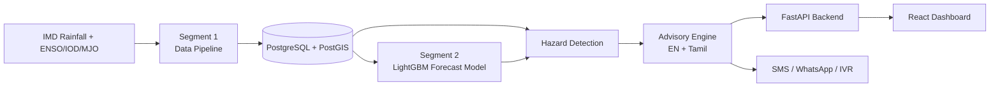

<div align="center">


</div>

## 📌 Overview

Monsoon forecasts in India are usually issued at the state or district level, far too coarse for a farmer deciding when to sow. **AgriVarsha** (monsoon-advisory) closes that gap: it predicts monsoon onset, false onset, dry spells, heavy-rain spells and monsoon revival at **block level, 1–4 weeks ahead**, then turns those hazard forecasts into plain-language (English + Tamil) crop advisories. Built for **Smart India Hackathon 2026**, the system runs a real IMD-rainfall data pipeline and a validated LightGBM forecasting model behind a live dashboard, with the demo scoped to Tamil Nadu but designed to be state-agnostic.

## ✨ Features

- 📡 Real daily-rainfall pipeline ingesting IMD gridded data (1991 → present) plus ENSO, IOD and MJO climate indices
- 🧠 LightGBM-based forecasting model (`s2-lgbm-...`) with confidence-rated 1–4 week forecasts
- ⚠️ Hazard detection for false onset, dry spells, heavy rain and monsoon revival, driven by observed rainfall
- 🌾 Advisory engine that drafts farmer-facing recommendations in English and Tamil with a review workflow and audit trail
- 🗺️ Interactive block/district map dashboard (React + Leaflet) with live data, no mock state on the frontend
- 🔀 Switchable forecast source — deterministic mock generator or the real trained model — toggled per deployment
- 📲 SMS/WhatsApp/IVR advisory delivery pipeline (simulated gateway, real advisory text)
- 🧪 Built-in demo scenarios (false onset trap, NE monsoon surge, mid-season break, normal season) for live walkthroughs

## 🛠️ Tech Stack

**Languages**


**ML**


**Backend**


**Database**


**Frontend**


**Tools**


**Also using**

     

## 🏗️ Architecture



## 📂 Project Structure

```
monsoon-advisory/
├── backend/
│   ├── pipeline/        # Segment 1 — IMD ingestion, climatology, features
│   ├── ml/               # Segment 2 — LightGBM forecasting model
│   ├── hazards/          # Hazard detection logic
│   ├── advisory/         # Advisory drafting + review workflow
│   ├── app/               # FastAPI backend (Segments 3–5, 7)
│   ├── delivery/         # SMS/WhatsApp/IVR gateway
│   ├── data/              # raw/ and processed/ (mostly git-ignored)
│   ├── tests/
│   └── requirements.txt
├── frontend/              # React + Vite + TypeScript dashboard
├── docs/contracts/        # Inter-segment data contracts
├── setup_db.bat            # One-click native PostgreSQL + PostGIS setup (Windows)
├── start_db.bat / stop_db.bat
└── docker-compose.yml      # Optional Docker alternative
```

## ⚙️ Installation

```bash
git clone https://github.com/Fayaz-2007/monsoon-advisory.git
cd monsoon-advisory

# Database (Windows, no admin rights needed)
setup_db.bat

# Backend
cd backend
py -3.11 -m venv .venv
.venv\Scripts\activate
pip install -r requirements.txt

# Frontend
cd ../frontend
npm install
```

### Environment variables (`backend/.env`)

| Variable | Description |
|---|---|
| `DATABASE_URL` | PostgreSQL + PostGIS connection string |
| `FORECAST_SOURCE` | `mock` (default) or `real` to use the trained LightGBM model |
| `CDS_API_KEY` | Optional — enables ERA5 climate data ingestion |
| `LLM_API_KEY` | Optional — enables Claude-powered plain-language rewording |

## 🚀 Usage

**One-click demo:**

```bash
run_demo.bat
```

This starts PostgreSQL, the FastAPI backend (`:8000`), the React frontend (`:5173`) and opens the dashboard. Press **D** in the app for demo scenario controls.

**Manual pipeline run:**

```bash
cd backend
python -m pipeline.run --stage all --start 1991-01-01 --end 2025-12-31
python -m app.seed --scenarios
uvicorn app.main:app --reload
```


## 🔮 Future Improvements

- Expand beyond Tamil Nadu to additional states using the existing state-agnostic pipeline
- Replace the simulated SMS/WhatsApp/IVR gateway with a real delivery integration
- Move farmer-count data from mock to a real district × crop dataset
- Promote the real LightGBM forecast source to default once validated further

## 👨‍💻 Author

**Fayaz Ahmed**
GitHub: [@Fayaz-2007](https://github.com/Fayaz-2007)
LinkedIn: [fayaz-ahmed-59287631a](https://linkedin.com/in/fayaz-ahmed-59287631a)

<div align="center">


</div>
